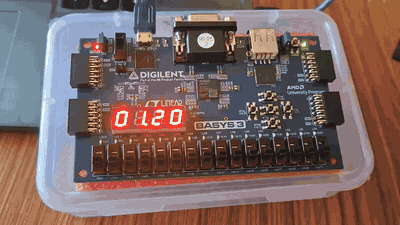
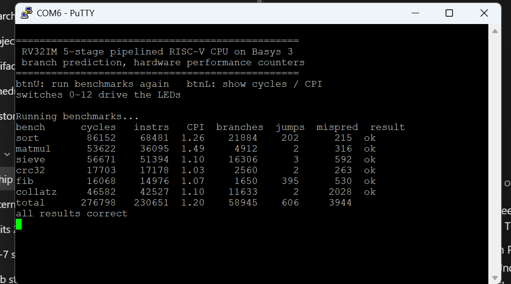

# RV32IM 5-Stage Pipelined RISC-V CPU

A 32-bit RISC-V processor written in Verilog, with a classic 5-stage pipeline
(Fetch, Decode, Execute, Memory, Writeback). It runs compiled C programs, passes the
official RISC-V ISA tests for the base integer and multiply/divide instructions, and predicts
branches with a branch target buffer (1.26x faster on the benchmark suite).

Started as an e-Yantra Logic Quest (IIT Bombay) task, then extended with the M extension,
block-RAM memories, memory-mapped I/O, a C toolchain, branch prediction, hardware performance
counters and a full verification flow. Runs on a **Digilent Basys 3 (Xilinx Artix-7)** with a
UART console and a UART program loader, so new programs load in under a second without
rebuilding the bitstream.

## Features

| Area | Details |
|---|---|
| ISA | RV32I base integer (37 instructions) + RV32M (mul, mulh, mulhsu, mulhu, div, divu, rem, remu) |
| Pipeline | 5 stages, full forwarding from Memory and Writeback, register-file write-through bypass |
| Hazards | Load-use stall (1 cycle), divide stall, 2-cycle flush on a wrong branch guess |
| Branch prediction | 32-entry branch target buffer with 2-bit counters, looked up in Fetch, checked in Execute |
| Performance counters | cycles, instructions retired, branches, jumps, mispredictions (memory mapped) |
| Multiply | Single cycle, mapped onto the FPGA's hard multiplier blocks |
| Divide | 33-cycle restoring divider, stalls the front of the pipeline while busy |
| Memory | Harvard: 16 KB instruction RAM + 16 KB data RAM, both mapped to block RAM, byte/half/word access |
| I/O | Memory-mapped console, LEDs and TOHOST (pass/fail) register |
| Software | GCC (`-march=rv32im`), linker script, startup code, small console library |
| FPGA | Basys 3 (Artix-7 XC7A35T): MMCM clocking, UART console, 7-segment display, LEDs, switches, buttons |
| Program loader | hardware UART loader with checksum: `python sw/load.py COM5 bench` |
| Accelerator | 4x4 INT8 systolic array (16 MACs/cycle), memory mapped, C driver: **10.5x** faster 32x32 matmul |

## Block diagram

See [`assets/architecture.pdf`](assets/architecture.pdf) for the pipeline datapath.

```
 Fetch          Decode            Execute                   Memory         Writeback
 PC -> IMEM  -> regfile, imm  ->  ALU / mul-div / branch -> DMEM / I/O  ->  result mux
   ^                                   |  forwarding <---------+--------------+
   +---------- branch / jump target ---+
```

## Memory map

| Address | Size | Use |
|---|---|---|
| `0x0000_0000` | 16 KB | Instruction memory (code) |
| `0x0001_0000` | 16 KB | Data memory (globals, constants, stack) |
| `0x1000_0000` | | UART_TX: send a character |
| `0x1000_0004` | | TOHOST: write 1 = pass, `(n << 1) \| 1` = fail at check n |
| `0x1000_0008` | | LEDS: 16 board LEDs |
| `0x1000_000C` | | UART_STATUS: TX full, TX busy, RX byte waiting |
| `0x1000_0010` | | CYCLES counter |
| `0x1000_0014` | | INSTRET counter (instructions retired) |
| `0x1000_0018` | | BRANCHES counter |
| `0x1000_001C` | | JUMPS counter |
| `0x1000_0020` | | MISPREDICTS counter |
| `0x1000_0024` | | HEX: value for the 7-segment display (+ decimal points) |
| `0x1000_0028` | | SWITCHES |
| `0x1000_002C` | | BUTTONS |
| `0x1000_0030` | | UART_RX: received byte |
| `0x2000_0000` | | Matrix accelerator: CTRL, A / B buffers, C results (see `docs/accelerator_notes.md`) |

## Branch prediction results

`sw/programs/bench`: six self-checking C kernels, counted by the hardware counters.
Same RTL, prediction switched off with `-DNO_BPRED`.

| Kernel | CPI, no prediction | CPI, with prediction | Mispredicts (off -> on) |
|---|---|---|---|
| sort (insertion) | 1.58 | 1.26 | 11,246 -> 215 |
| matmul 16x16 | 1.72 | 1.49 | 4,607 -> 316 |
| sieve | 1.53 | 1.10 | 11,633 -> 592 |
| crc32 | 1.27 | 1.03 | 2,304 -> 263 |
| fib (recursive) | 1.16 | 1.07 | 1,189 -> 530 |
| collatz | 1.45 | 1.10 | 9,613 -> 2,028 |
| **Total** | **1.52** | **1.20** | **40,592 -> 3,944 (-90 %)** |

Total cycles 350,096 -> 276,800: **1.26x faster**. matmul stays at 1.49 because its setup uses
`%` (a 33-cycle divide) 512 times, not because of branches. fib keeps the most mispredicts
because function returns (`jalr`) are not predicted; a return address stack would fix that.

## Matrix-multiply accelerator

A 4x4 systolic array of INT8 multiply-accumulate units: A flows right, B flows down, each
processing element keeps one element of C. 16 multiply-adds per cycle, a 4x4 tile with K
steps takes K + 6 cycles. Details and design reasoning: [`docs/accelerator_notes.md`](docs/accelerator_notes.md).

| 32x32x32 INT8 matmul (`sw/programs/matmul`) | Cycles |
|---|---|
| CPU only | 238,905 |
| CPU + accelerator | 22,806 (**10.5x faster**, results identical) |

About 90 % of the accelerated time is the CPU moving data in and out; the array computes for
only ~2,400 cycles. A DMA engine is the natural next step.

## Verification

Three independent checks, all run on every change:

1. **Official riscv-tests**: all 48 `rv32ui` and `rv32um` tests pass, with branch prediction
   on and off (`fence_i` and `ma_data` are skipped on purpose, see below).
2. **Random differential testing**: random RV32IM programs, built to hit forwarding, load-use,
   branches, jumps, loops and back-to-back divides, run on both the RTL and a Python reference model.
   The full commit log (every register write and every store, in order) and the final state
   must match. 120 programs, ~46,600 instructions, 0 mismatches.
3. **Directed testbench** from e-Yantra: 38 instruction checks, all pass.
4. **Accelerator unit test**: 1,000 random tiles (K = 1..64, edge values, accumulate mode),
   cycle-exact timing, plus a full-system check against the CPU's own result.

The random test was checked by planting bugs in the design (removing the load-use stall,
breaking forwarding, wrong divide-by-zero result, missing pipeline bubble during divide,
missing reset flush, missed "predicted taken but not taken" case, wrong redirect address).
Every planted bug was caught.

## Results (Cyclone IV E, EP4CE22F17C6, Quartus Prime Lite 20.1)

| | Phase 1 (RV32IM) | Phase 2 (+ branch prediction) |
|---|---|---|
| Fmax (slow 85 C model) | 57.0 MHz | 56.33 MHz |
| Logic elements | 2,414 (11 %) | 3,378 (15 %) |
| Registers | 650 | 1,196 |
| Memory bits | 264,192 (34 M9K) | 264,800 |
| 9-bit multiplier elements | 8 | 8 |
| CPI on the benchmark suite | 1.52 | 1.20 |

Timing is met at the 50 MHz target in both. The branch target buffer is kept in flip-flops
(about 550 registers) so it can be read in the same cycle as Fetch; it is not on the critical
path. Net speedup including the small Fmax change: 1.26 x 56.33 / 57.0 = **1.25x**.

Timing work done so far:
1. The first critical path was data memory read (falling edge) -> load byte select and sign
   extend -> MEM/WB, in half a cycle. The byte select moved to Writeback (`load_extend.v`).
2. That exposed the branch path: forwarding -> ALU input muxes -> ALU subtract -> branch
   decision -> flush. Branches now use their own comparator and `jalr` its own adder, fed
   directly from the forwarded registers.
3. The critical path is now: load data in Writeback -> forwarding -> single-cycle multiplier
   -> EX/MEM (17.5 ns). Several paths now sit close to the same delay, so the next real gain
   needs a structural change: a 2-cycle (registered) multiplier and rising-edge memories.

## On the Basys 3

Step by step: [`docs/basys3_guide.md`](docs/basys3_guide.md).

```
vivado -mode batch -source fpga/basys3/build.tcl      # bitstream with the demo program
vivado -mode batch -source fpga/basys3/program.tcl    # program the board over USB
python sw/load.py COM5 bench                         # load another program, see its output
```

After reset the demo prints the benchmark table measured on the board, shows the CPI on
the 7-segment display ("1.20"), and lets the switches drive the LEDs.





The board reports 276,798 cycles for the whole suite, exactly the same as RTL simulation.

| Basys 3 (XC7A35T-1, Vivado 2026.1) | |
|---|---|
| CPU clock | 50 MHz from the MMCM, timing met (worst slack +2.72 ns, about 58 MHz max) |
| Slice LUTs | 1,939 / 20,800 (9.3 %) |
| Slice registers | 1,207 / 41,600 (2.9 %) |
| Block RAM | 9 tiles (16 KB IMEM + 16 KB DMEM) |
| DSP48E1 | 4 (single-cycle multiplier) |
| Critical path | forwarding compare -> ALU / multiplier -> EX/MEM register |

## How to run (simulation)

Needs `iverilog`, `python3` and a RISC-V GCC (`riscv64-unknown-elf-gcc`, or the xPack
`riscv-none-elf-gcc` on Windows with `CROSS=riscv-none-elf-`).

```bash
# C program on the CPU
cd sw && make PROG=hello sim

# benchmarks with and without branch prediction
cd sw && make PROG=bench sim && make PROG=bench sim VFLAGS=-DNO_BPRED

# official ISA tests
verif/run_riscv_tests.sh

# random differential test (100 programs)
verif/run_random.sh 100

# Basys 3 top level: UART output, program loader, damaged-program rejection
verif/run_board_tests.sh

# everything
verif/run_all.sh

# original e-Yantra testbench (run from code/ so it finds imem.hex)
cd code && iverilog -g2005 -o tb ../.test/tb.v *.v components/*.v io/*.v accel/*.v && vvp tb
```

To put a C program on the FPGA: `make PROG=hello install` copies its hex files into `code/`,
then compile in Quartus.

## Repository layout

```
code/             RTL: soc.v (CPU + memories + I/O), pl_riscv_cpu.v (e-Yantra wrapper)
code/components/  pipeline blocks: datapath, hazard unit, ALU, mul/div unit, branch predictor
code/io/          UART TX/RX, UART program loader, 7-segment driver
code/accel/       INT8 systolic-array matrix-multiply accelerator
fpga/basys3/      Basys 3 top level, pin constraints, Vivado build / program scripts
sw/               C toolchain: link.ld, crt0.S, console library, programs/, Makefile
sw/prebuilt/      hello, bench, demo, ready to load (no RISC-V compiler needed)
sw/load.py        sends a program to the board over USB-UART
verif/            riscv-tests runner, random test generator + reference model, board-level
                  testbench with a UART model, testbenches
.test/tb.v        original e-Yantra directed testbench
docs/             design notes for each phase
```

## Known limitations

- No misaligned loads/stores (the ISA allows a core to not support them).
- No CSRs, traps or interrupts, so no ECALL/EBREAK and no operating system.
- Code cannot be modified at run time (separate instruction memory), so `fence.i` is a no-op.
- A wrong branch guess costs 2 cycles (branches resolve in Execute).
- Function returns (`jalr`) are not predicted.
- Performance counters are 32 bits, so they wrap after about 85 s at 50 MHz.

## Roadmap

- [x] Phase 1: RV32M, block-RAM memories, MMIO, C toolchain, riscv-tests
- [x] Phase 2: performance counters, branch prediction (BTB + 2-bit counters), benchmarks
- [x] Basys 3: UART console, display / LEDs / switches, UART program loader
- [x] INT8 systolic-array accelerator, memory mapped, driven from C
- [ ] DMA for the accelerator (it fetches its own data)
- [ ] RTL-to-GDSII of the core with OpenLane (SkyWater 130 nm)
- [ ] Interrupts and CSRs (timer interrupt, trap handling)
- [ ] Games: Snake / Tetris in the UART terminal, then a VGA framebuffer (Pong / Snake on a monitor)
