# RV32IM 5-Stage Pipelined RISC-V CPU with a CNN Accelerator

My own RISC-V processor and neural-network accelerator in Verilog, running on a Basys 3 FPGA,
verified with UVM on Cadence Xcelium and laid out on SkyWater 130 nm.

<p align="center">
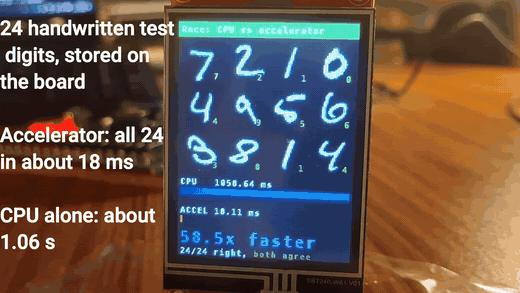<br>
<i>Live on the board: my accelerator classifies 24 handwritten digits in 18 ms while my CPU alone
needs 1.06 s. 58.5x faster, same answers, 24/24 right.</i>
</p>

| At a glance | |
|---|---|
| **CPU** | RV32IM, 5-stage pipeline with forwarding and branch prediction, 50 MHz on a Basys 3; passes all 48 official `rv32ui` / `rv32um` riscv-tests |
| **Accelerator** | 4x4 INT8 systolic array + gather engine (im2col in hardware) + layer engine (one command per conv layer, pooling in hardware), double-buffered: **58.4x** on an MNIST CNN and **46x** on edge filtering, measured on the board, bit-exact against a Python golden model |
| **Verification** | Two **UVM** environments on Cadence Xcelium: 10/10 core and 7/7 accelerator tests, 235/235 core functional bins, 100 % accelerator functional coverage, SVA, a C reference model over DPI-C, planted bugs caught |
| **Silicon** | RTL to GDSII on SkyWater 130 nm (LibreLane): 0.52 mm², DRC/LVS clean |
| **Live demos** | Digit recognition (drawn on the laptop or with a mouse on the board), real-time edge filter, CPU vs accelerator race, Tetris, a Wolfenstein-style 3D raycaster; own SPI display and PS/2 mouse controllers |

A 32-bit RISC-V processor written in Verilog, with a classic 5-stage pipeline
(Fetch, Decode, Execute, Memory, Writeback). It runs compiled C programs, passes the
official RISC-V ISA tests for the base integer and multiply/divide instructions, and predicts
branches with a branch target buffer (1.26x faster on the benchmark suite).

Started as an e-Yantra Logic Quest (IIT Bombay) task, then extended with the M extension,
block-RAM memories, memory-mapped I/O, a C toolchain, branch prediction, hardware performance
counters and a full verification flow. Runs on a **Digilent Basys 3 (Xilinx Artix-7)** with a
UART console and a UART program loader, so new programs load in under a second without
rebuilding the bitstream.

Runs a **handwritten-digit recognition neural network** (INT8 CNN, 98.74 % on MNIST) on its own
**systolic-array accelerator with a hardware layer engine**: **58.4x faster** than the CPU
alone, measured on the board, with every output bit-identical to a Python golden model.

Hardened into a **SkyWater 130 nm layout** (RTL to GDSII with LibreLane), and verified with two **UVM** environments on Cadence Xcelium (constrained-random programs checked
commit by commit against a C reference model over DPI-C, SVA, functional and code coverage in
IMC), with planted bugs to prove the testbenches catch real failures.

## Live on the board

Frames from the demo video, all running on the Basys 3 at 50 MHz (switches pick the mode;
programs load over UART without rebuilding the FPGA). [How to run it](#live-demo-on-a-24-tft)

<table>
<tr>
<td width="50%">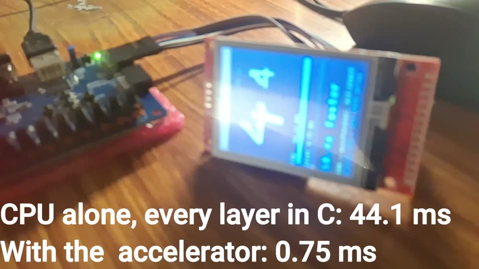<br><b>Digit recognition:</b> drawn on the laptop, recognised on the board twice: 44.1 ms on the CPU alone, 0.75 ms with the accelerator, identical scores.</td>
<td width="50%">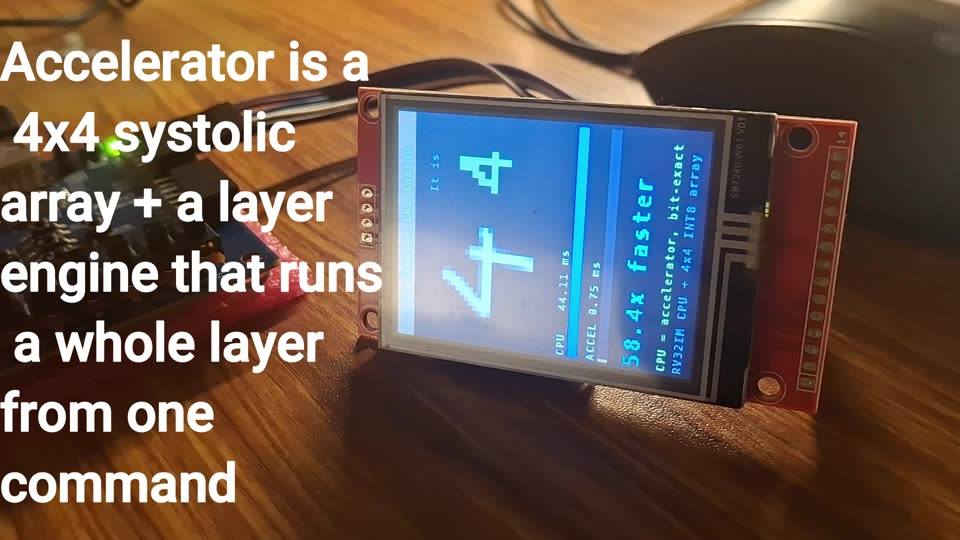<br><b>The accelerator:</b> a 4x4 systolic array driven by a layer engine that runs a whole convolution layer from one command. Speedup on the 7-segment display.</td>
</tr>
<tr>
<td>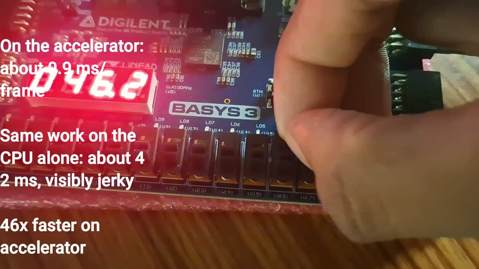<br><b>Real-time edge filter:</b> four 3x3 filters per frame, 0.9 ms on the accelerator vs 42 ms on the CPU (46x); one switch swaps them live.</td>
<td>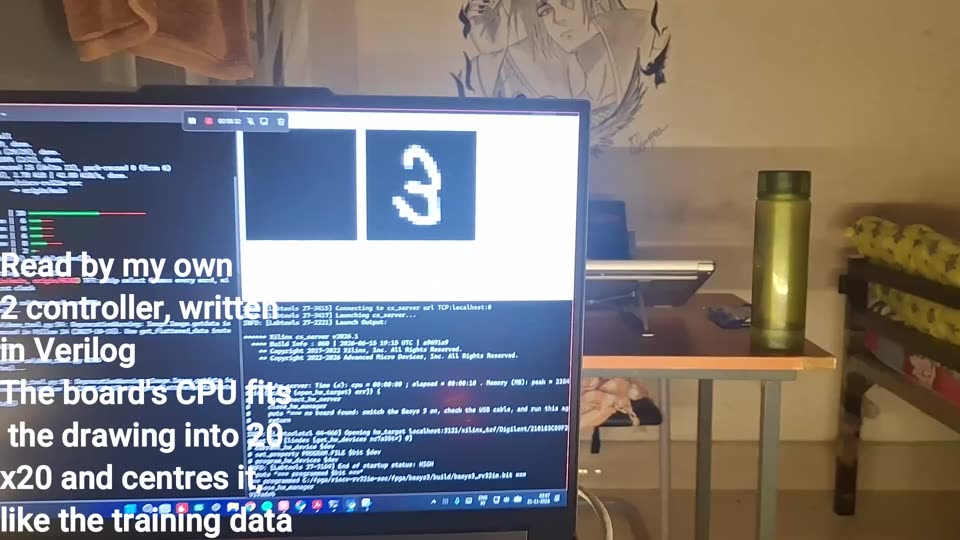<br><b>Drawing with a mouse on the board:</b> my PS/2 controller reads the mouse; the board prepares the 28x28 image and recognises it; the laptop only mirrors it.</td>
</tr>
<tr>
<td>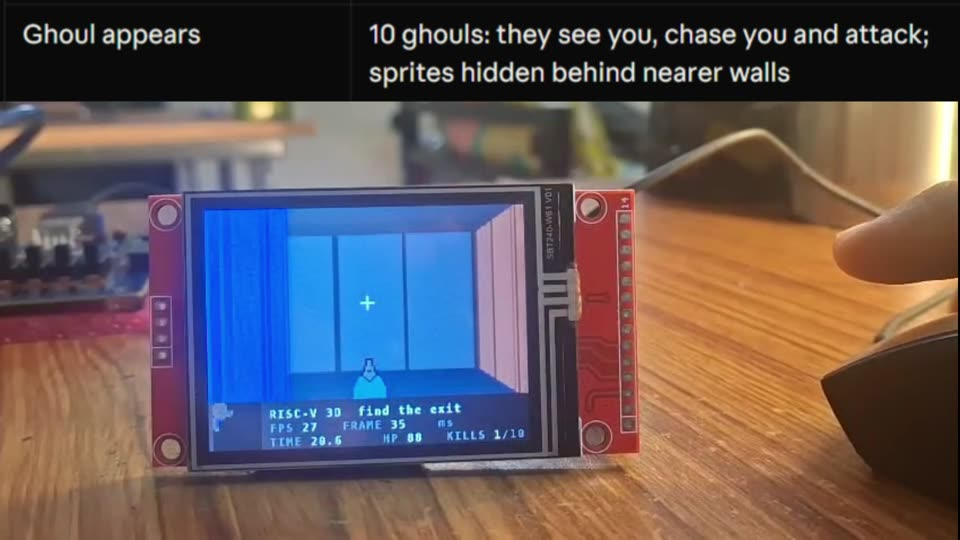<br><b>3D raycaster with ghouls:</b> 160 rays per frame in fixed point (no FPU), only changed pixels redrawn with hardware fills, 25 to 80 FPS.</td>
<td>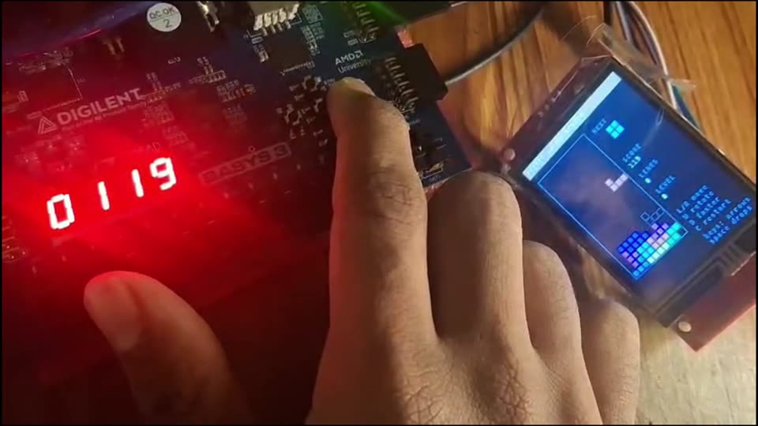<br><b>Tetris:</b> written in C for my CPU, score on the 7-segment display; buttons, keyboard or mouse.</td>
</tr>
</table>

## Highlights

### The accelerator

<table>
<tr>
<td width="50%">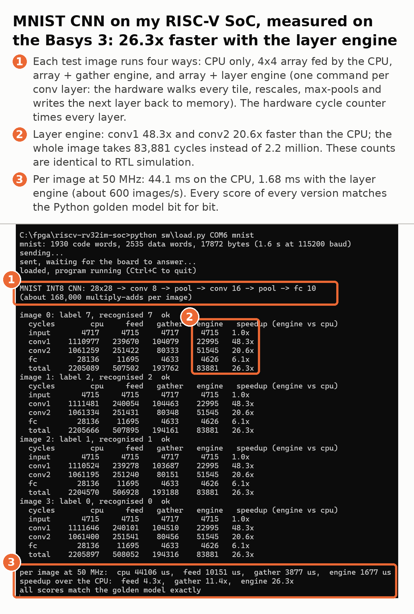<br><b>A neural network on my CPU, measured on the Basys 3:</b> a small INT8 CNN recognises MNIST digits four ways: CPU only, accelerator fed by the CPU, with its gather engine, and with its layer engine. The hardware cycle counter times every layer; the board numbers are identical to RTL simulation and every score matches the Python golden model. <a href="#neural-network-on-the-soc-mnist">Details</a></td>
<td width="50%">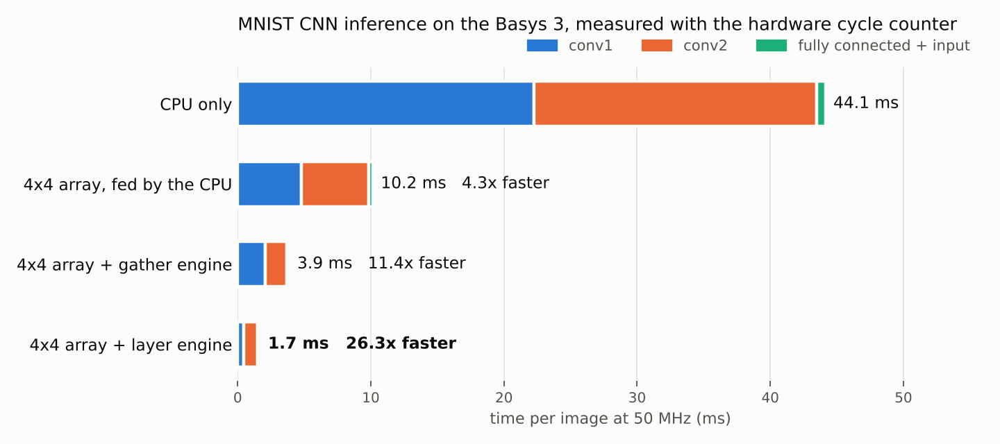<br><b>58.4x faster inference:</b> 44.1 ms per image on the CPU, 0.75 ms with the accelerator (about 1,320 images/s at 50 MHz). The first accelerator version was only 4.3x because the CPU spent its time moving data; each step after that came from measuring where the cycles went (gather engine 11.4x, layer engine 26.3x, deeper operand buffers 36.4x, parameters on chip 40.4x, double buffering 58.4x).</td>
</tr>
<tr>
<td colspan="2">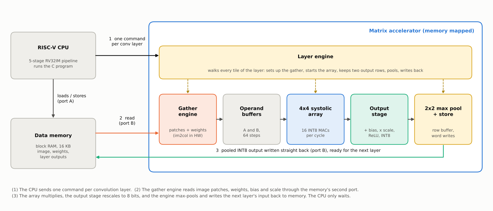<br><b>What I built for it:</b> a layer engine that runs a whole convolution layer from one command: it drives a gather engine that reads image patches and weights straight from data memory through the block RAM's second port (convolution turned into matrix multiplication, "im2col", in hardware), an output stage that adds the bias, rescales to 8 bits and applies ReLU, and a 2x2 max pool that writes the next layer's input back to memory. The CPU sends one command per layer and waits.</td>
</tr>
</table>

### Verification with UVM (Cadence Xcelium, IMC)

<table>
<tr>
<td width="50%">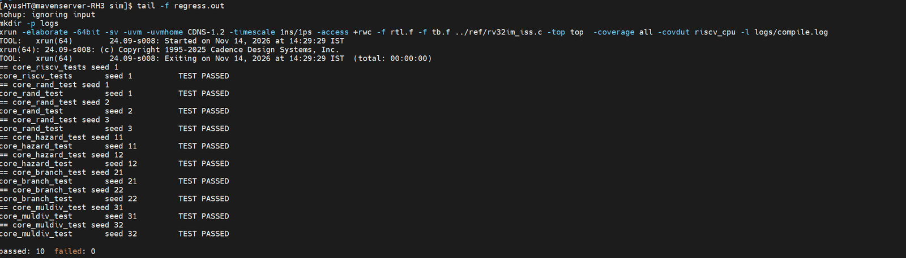<br><b>Core regression:</b> constrained-random programs, every register write and store checked against a C reference model over DPI-C. 10/10 core tests pass. <a href="verif/uvm/README.md">UVM details</a></td>
<td width="50%">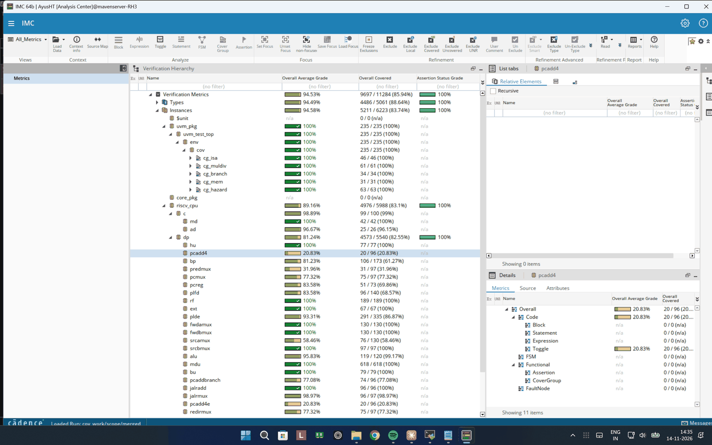<br><b>Coverage closure in IMC:</b> 235/235 functional coverage bins, all pipeline assertions passing; code-coverage holes waived with design reasons.</td>
</tr>
<tr>
<td>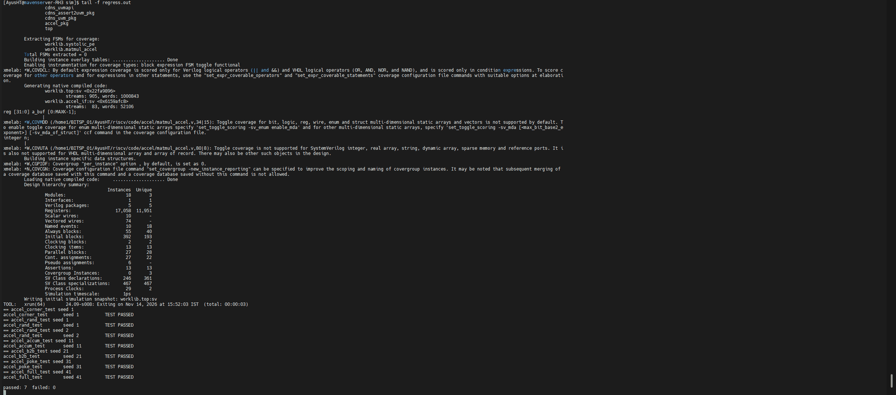<br><b>Accelerator environment:</b> its own UVM testbench; every 4x4 result tile is checked against a reference model and every run must take exactly K + 6 cycles. 7/7 tests pass.</td>
<td>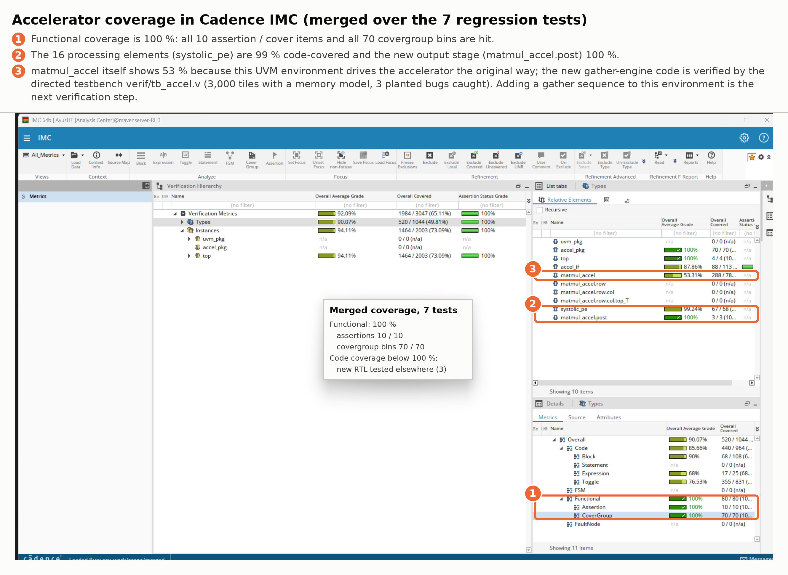<br><b>Accelerator coverage:</b> cross coverage of K x clear, the extreme INT8 products and the result ranges: 100 % functional coverage, 10/10 SVA assertions passing.</td>
</tr>
<tr>
<td>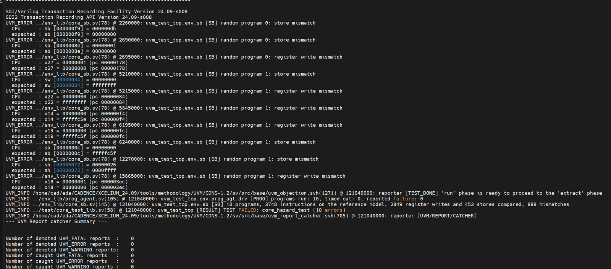<br><b>The testbench catches real bugs:</b> a load-use stall broken on purpose gives 889 mismatches and TEST FAILED.</td>
<td>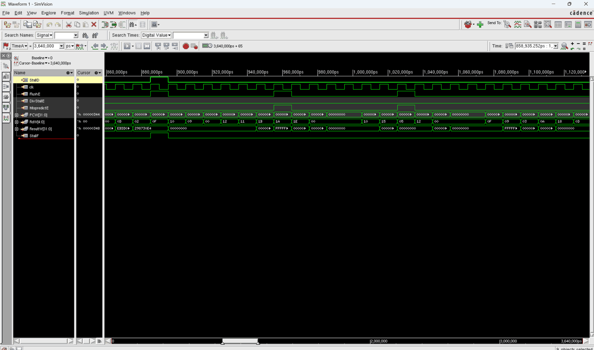<br><b>Pipeline in SimVision:</b> a load-use stall (one bubble) and two branch mispredicts flushing Execute.</td>
</tr>
</table>

### Chip layout and FPGA

<table>
<tr>
<td width="50%">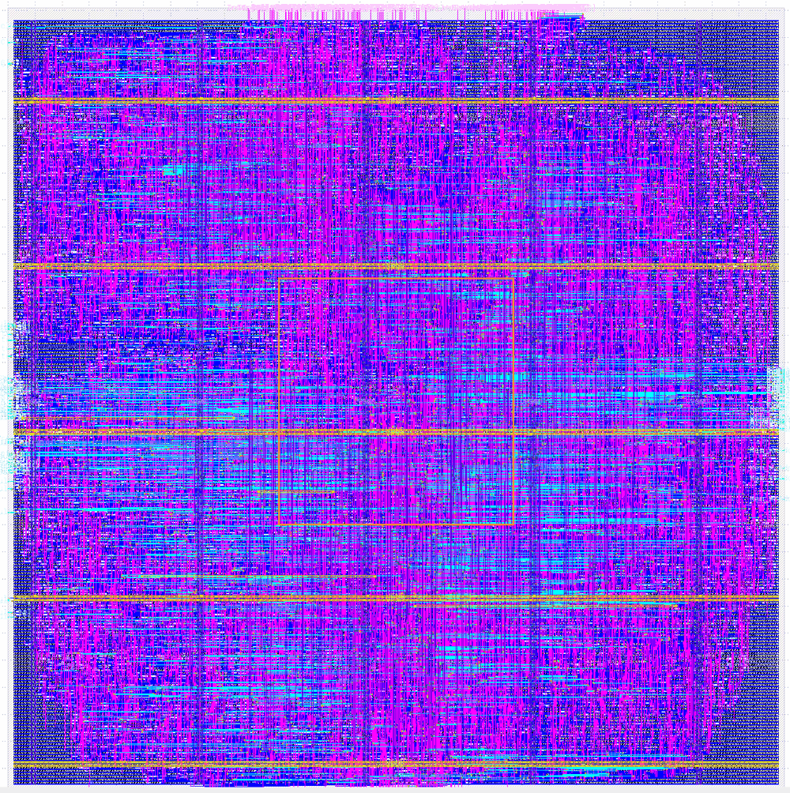<br><b>The core as a chip:</b> hardened on SkyWater 130 nm with LibreLane. 0.52 mm², about 18k cells, DRC/LVS clean, timing closed at 20 MHz in all corners. <a href="asic/riscv_cpu/README.md">Layout details</a></td>
<td width="50%">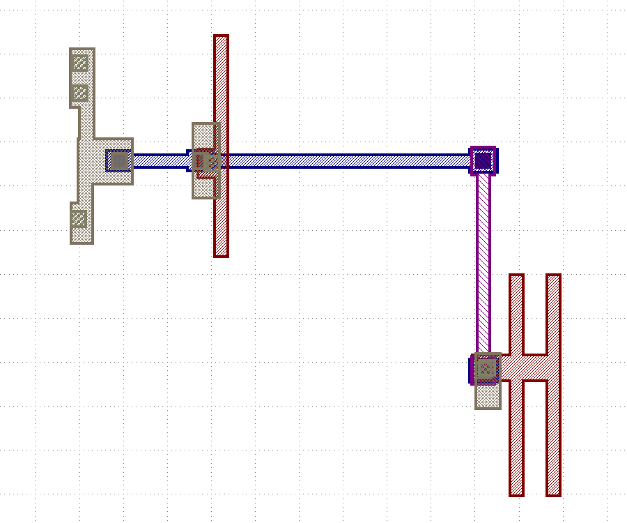<br><b>Down to the transistors:</b> one signal traced through the layout, from a cell output on PMOS/NMOS diffusion, over metal 1 and a via, to the gates of two other cells.</td>
</tr>
<tr>
<td><br><b>Running on a Basys 3 FPGA:</b> benchmarks over UART, switches and LEDs, cycle count on the display.</td>
<td>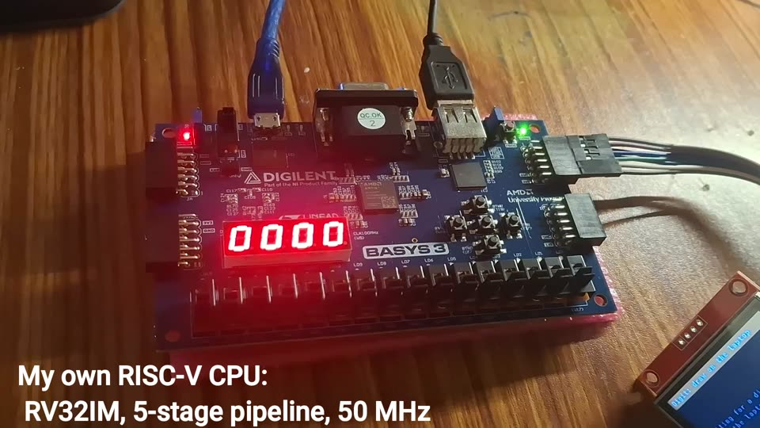<br><b>The whole setup:</b> Basys 3, 2.4" SPI TFT and a USB mouse on the board's PS/2 port.</td>
</tr>
</table>

## Features

| Area | Details |
|---|---|
| ISA | RV32I base integer (37 instructions) + RV32M (mul, mulh, mulhsu, mulhu, div, divu, rem, remu) |
| Pipeline | 5 stages, full forwarding from Memory and Writeback, register-file write-through bypass |
| Hazards | Load-use stall (1 cycle), divide stall, 2-cycle flush on a wrong branch guess |
| Branch prediction | 32-entry branch target buffer with 2-bit counters, looked up in Fetch, checked in Execute |
| Performance counters | cycles, instructions retired, branches, jumps, mispredictions (memory mapped) |
| Multiply | Single cycle, mapped onto the FPGA's hard multiplier blocks |
| Divide | 33-cycle restoring divider, stalls the front of the pipeline while busy |
| Memory | Harvard: 16 KB instruction RAM + 32 KB data RAM, both mapped to block RAM, byte/half/word access |
| I/O | Memory-mapped console, LEDs and TOHOST (pass/fail) register |
| Software | GCC (`-march=rv32im`), linker script, startup code, small console library |
| FPGA | Basys 3 (Artix-7 XC7A35T): MMCM clocking, UART console, 7-segment display, LEDs, switches, buttons |
| Program loader | hardware UART loader with checksum: `python sw/load.py COM5 bench` |
| Accelerator | 4x4 INT8 systolic array (16 MACs/cycle) with a **layer engine** (one command per conv layer, 2x2 max pool in hardware), a **gather engine** (reads its own operands from data memory: im2col in hardware) and an **output stage** (bias, rescale, ReLU in hardware). 10.5x faster 32x32 matmul |
| Neural network | INT8 CNN for MNIST (98.74 %), trained in NumPy, bit-exact C on the SoC: **58.4x** faster than the CPU on the board ([details](#neural-network-on-the-soc-mnist)) |
| ASIC | Hardened on SkyWater 130 nm with LibreLane: 0.52 mm², DRC/LVS clean, timing closed at 20 MHz in all corners ([details](asic/riscv_cpu/README.md)) |
| Verification | UVM on Xcelium + IMC: 48/48 riscv-tests in UVM, 17/17 regression tests pass, 100% functional coverage, SVA, bug injection |

## Block diagram

See [`assets/architecture.pdf`](assets/architecture.pdf) for the pipeline datapath.

```
 Fetch          Decode            Execute                   Memory         Writeback
 PC -> IMEM  -> regfile, imm  ->  ALU / mul-div / branch -> DMEM / I/O  ->  result mux
   ^                                   |  forwarding <---------+--------------+
   +---------- branch / jump target ---+
```

## Memory map

| Address | Size | Use |
|---|---|---|
| `0x0000_0000` | 16 KB | Instruction memory (code) |
| `0x0001_0000` | 32 KB | Data memory (globals, constants, stack) |
| `0x1000_0000` | | UART_TX: send a character |
| `0x1000_0004` | | TOHOST: write 1 = pass, `(n << 1) \| 1` = fail at check n |
| `0x1000_0008` | | LEDS: 16 board LEDs |
| `0x1000_000C` | | UART_STATUS: TX full, TX busy, RX byte waiting |
| `0x1000_0010` | | CYCLES counter |
| `0x1000_0014` | | INSTRET counter (instructions retired) |
| `0x1000_0018` | | BRANCHES counter |
| `0x1000_001C` | | JUMPS counter |
| `0x1000_0020` | | MISPREDICTS counter |
| `0x1000_0024` | | HEX: value for the 7-segment display (+ decimal points) |
| `0x1000_0028` | | SWITCHES |
| `0x1000_002C` | | BUTTONS |
| `0x1000_0030` | | UART_RX: received byte |
| `0x2000_0000` | | Matrix accelerator: CTRL, gather descriptors, A / B buffers, C results, INT8 results, bias / scale (register list at the top of `code/accel/matmul_accel.v`) |
| `0x3000_0000` | | TFT display (SPI): CTRL, STATUS, CMD, DATA, PIXEL, PIXEL2, FILL (`code/io/tft_spi.v`) |
| `0x4000_0000` | | PS/2 mouse: RX (32-byte FIFO), TX (commands to the mouse), STATUS (`code/io/ps2.v`) |

## Branch prediction results

`sw/programs/bench`: six self-checking C kernels, counted by the hardware counters.
Same RTL, prediction switched off with `-DNO_BPRED`.

| Kernel | CPI, no prediction | CPI, with prediction | Mispredicts (off -> on) |
|---|---|---|---|
| sort (insertion) | 1.58 | 1.26 | 11,246 -> 215 |
| matmul 16x16 | 1.72 | 1.49 | 4,607 -> 316 |
| sieve | 1.53 | 1.10 | 11,633 -> 592 |
| crc32 | 1.27 | 1.03 | 2,304 -> 263 |
| fib (recursive) | 1.16 | 1.07 | 1,189 -> 530 |
| collatz | 1.45 | 1.10 | 9,613 -> 2,028 |
| **Total** | **1.52** | **1.20** | **40,592 -> 3,944 (-90 %)** |

Total cycles 350,096 -> 276,800: **1.26x faster**. matmul stays at 1.49 because its setup uses
`%` (a 33-cycle divide) 512 times, not because of branches. fib keeps the most mispredicts
because function returns (`jalr`) are not predicted; a return address stack would fix that.

## Matrix-multiply accelerator

A 4x4 systolic array of INT8 multiply-accumulate units: A flows right, B flows down, each
processing element keeps one element of C. 16 multiply-adds per cycle, a 4x4 tile with K
steps takes K + 6 cycles. Details and design reasoning: [`docs/accelerator_notes.md`](docs/accelerator_notes.md).

| 32x32x32 INT8 matmul (`sw/programs/matmul`) | Cycles |
|---|---|
| CPU only | 238,905 |
| CPU + accelerator | 22,806 (**10.5x faster**, results identical) |

About 90 % of the accelerated time is the CPU moving data in and out; the array computes for
only ~2,400 cycles. That observation led to the gather and layer engines below.

## Neural network on the SoC (MNIST)

A small convolutional network recognises handwritten digits (28x28 images from MNIST),
trained in plain NumPy, converted to 8-bit integers, and run on the SoC in C:

```
28x28 image -> conv 3x3, 8 filters, ReLU -> 2x2 max pool -> 13x13x8
            -> conv 3x3, 16 filters, ReLU -> 2x2 max pool -> 5x5x16
            -> fully connected 400 -> 10 scores (the largest is the digit)
5,258 weights, about 168,000 multiply-adds per image
```

**Accuracy** on the 10,000 MNIST test images: 98.78 % in floating point, **98.74 % in INT8**.
The INT8 network is defined by a golden model (`ml/mnist/quantize.py`): every other version
must produce exactly its scores, bit for bit.

**How a convolution runs on a matrix-multiply array.** Each output pixel's 3x3xC input patch
becomes one row of a matrix A and each filter one column of B, so A x B is the convolution
("im2col", the way TPUs and NPUs run CNNs). The array computes 4 pixels x 4 filters at a time.

**Four versions, measured on the Basys 3** (`sw/programs/mnist`, cycles per image from the
hardware counter; identical to RTL simulation):

| Layer | CPU only | Array fed by the CPU | + gather engine | + layer engine | Speedup |
|---|---|---|---|---|---|
| conv1 | 1,110,977 | 239,670 | 104,079 | **10,967** | 101x |
| conv2 | 1,061,259 | 251,422 | 80,333 | **17,437** | 60.9x |
| fully connected | 28,136 | 11,695 | 4,633 | **4,626** | 6.1x |
| **Total** | **2,205,089** | 507,502 (4.3x) | 193,762 (11.4x) | **37,745 (58.4x)** | |
| Per image at 50 MHz | 44.1 ms | 10.2 ms | 3.9 ms | **0.75 ms (about 1,320 images/s)** | |

**How the speedup was found, step by step:**

1. **Array fed by the CPU: 3.3x at first.** Counting the cycles showed the array was busy only
   about 2.6 % of the time. The CPU spent the rest building patches, copying words into the
   array, and rescaling every result with a 64-bit multiply.
2. **Output stage (4.3x):** bias, rescale to 8 bits and ReLU in hardware, in the 6 cycles after a
   run, so the CPU reads 4 finished words instead of 16 sums.
3. **Gather engine (11.4x):** the accelerator reads its own operands through the data memory's
   second block-RAM port. The CPU writes a descriptor (start address, three nested loop counts
   and byte strides, and the gap between the 4 pixels) and one command; the engine builds the
   im2col patches, loads the weights and starts the run.
4. **Layer engine (26.3x):** with the gather engine, the CPU still spent most of its time on
   bookkeeping: one descriptor per tile, reading results back, pooling in software. The layer
   engine takes one command per convolution layer (input, output, weights, bias, scale and the
   layer shape) and walks every tile itself: it loads each filter group's bias and scale, issues
   the gathers, keeps two output rows in a small buffer, max-pools them and writes the pooled
   INT8 values straight back to data memory, which is the next layer's input.

5. **128-step operand buffers (36.4x):** profiling the layer engine showed 62 % of its time
   went on fetching operands. conv2's 3x3x8 patch is 72 steps, more than the 64-step buffers
   held, so it ran in two pieces and every patch was fetched again for each group of 4 filters.
   With 128-step buffers the whole patch runs in one piece and is fetched once for all filter
   groups: conv2 went from 51,545 to 28,301 cycles.
6. **Parameters on chip, background stores (40.4x):** the next profile showed conv1 spending
   39 % of its time on bookkeeping, mostly reading the same bias and scale from memory for every
   4x4 tile. The engine now reads them for all filters once per layer and copies a group's 4
   values in one cycle. Finished results are latched and written into the pooling buffer while
   the next tile is already being fetched. Bookkeeping halved; conv1 went to 18,423 cycles.

7. **Double buffering (58.4x):** that left fetching at 54 % of the engine's time, with the array
   waiting. The operand buffers now have two banks, and the engine is two state machines working
   at the same time: a fetch side gathers the next job's patch and weights into the free bank
   while a compute side runs the array from the other, through a 2-entry job queue. A patch is
   still fetched once for all filter groups (its bank changes only when a new patch is fetched),
   and fetching pauses while pooling writes through the shared memory port. conv1 reached 101x.

**Where it stands now:** with fetching and computing overlapped, a layer takes about as long as
its fetching. The engine reads memory through one block-RAM port (4 bytes per cycle at most,
1 byte per cycle for most patch reads), so the accelerator is limited by memory bandwidth, not by
the array. The input copy (4,715 cycles) and the fully connected layer (4,626) are a quarter of
the remaining time and do not use the layer engine, which caps the speedup near 235x until they
are accelerated too (Amdahl's law). See [Future work](#future-work).

**Verification:**

- **Accelerator unit test:** the output stage is checked on every tile with random bias and
  scale. Half of the tiles load through the gather engine, from a memory model with random
  contents, with random descriptors and alignments. 3,000 tiles pass. Three bugs planted in the
  engine are all caught; one was missed at first, which led to a new test case.
- **Layer engine:** `sw/programs/conv_test` runs 24 convolution layers with random shapes
  (1 to 24 channels, 4 to 16 filters, rows up to 32 pixels, odd sizes, partial tiles) and random
  data through the engine and checks every output byte against plain C, plus fixed cases: one
  126-step run (C = 14), three pieces of 126 steps (C = 42) and a single output column. All 24
  pass; a planted bug in the pooling compare fails 23 of them, a scale off by one fails 3. Widening
  this test found a real bug: with one output column and 4 filters, pooling read the last result
  one cycle before it was written (fixed with a wait state; MNIST never used that shape).
- **Double buffering:** planted bugs in the bank logic are caught by the random layers: the array
  always reading B from bank 0 fails 20 of 24 layers, the A bank never switching 13 of 24, the
  fetch side ignoring a slot that is still in use locks the engine up (the test times out).
  Freeing a slot as soon as its run starts is not caught and cannot fail: a gather writes at most
  one step per cycle and starts after the run, so it never overtakes the run reading that bank.
- **Parameters and background stores:** planted bugs in the new logic are all caught by the
  random layers: every group given group 0's bias and scale fails 20 of 24 layers, scales stored
  at the wrong index 14 of 24, pooling not waiting for the background store 1 of 24 (the
  one-column case, which is why it is a fixed test).
- **Buffers:** the accelerator unit test gathers up to the full 128 steps; dropping the top bit of
  the buffer index makes it fail 2,880 checks.
- **Software:** all four C versions match the golden model on all 10,000 test images (on the
  PC, with a software model of the accelerator) and on the RTL and the board.
- The full regression (riscv-tests, random programs, board tests, e-Yantra) still passes.

| Basys 3 after the accelerator work | Before | Now (double-buffered layer engine) |
|---|---|---|
| Slice LUTs | 1,939 | 6,755 (32.5 %), of which the accelerator 4,113 |
| Slice registers | 1,207 | 3,232 (7.8 %) |
| Block RAM | 9 tiles | 9 tiles: the gather and layer engines use the second port of the same RAMs |
| DSP48E1 | 4 | 15 (accelerator 11: output stage and the engine's address arithmetic; 75 of 90 still free) |
| Timing at 50 MHz | +2.72 ns | met, worst slack +1.96 ns |

Training, quantisation and the PC check: [`ml/mnist`](ml/mnist/README.md).

## Live demo on a 2.4" TFT

<p align="center">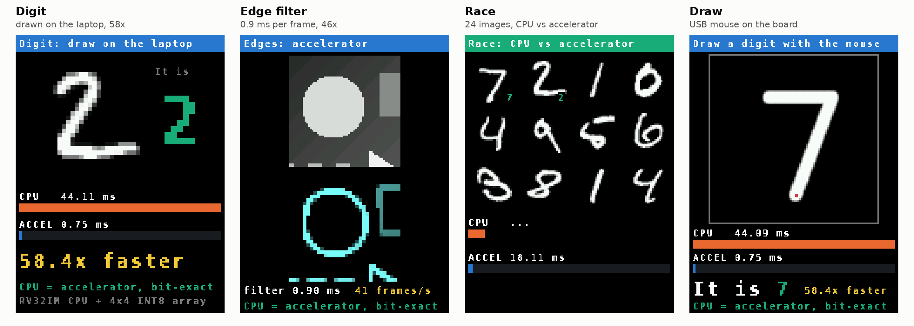</p>

`sw/programs/nn_demo` puts the accelerator on a 240x320 SPI display next to the board, in
four modes chosen with the switches:

| Mode | What happens |
|---|---|
| **Digit** | A digit drawn with the mouse on the laptop (`sw/demo_tool.py`) is sent over the UART. The board recognises it twice, on the CPU alone and with the accelerator, and shows the answer, both times and the speedup (44.1 ms vs 0.75 ms, 58x). |
| **Edge filter** | Four 3x3 Sobel filters (edges in four directions), ReLU and 2x2 max pooling on a 66x66 window that pans across a 96x96 picture, frame after frame. A switch moves the work between the CPU (42 ms per frame) and the layer engine (0.9 ms per frame, 46x), so the speed shows as smoothness. Any photo can be sent from the laptop. |
| **Race** | The CPU and the accelerator classify the same 24 images. The accelerator's bar is full after 18 ms; the CPU's bar takes about a second to fill. |
| **Draw** | A digit drawn on the TFT with a USB mouse plugged into the board. The board turns the 96x96 drawing into an MNIST-style 28x28 image itself (fitted into 20x20, centred by its centre of mass), recognises it on both, and sends the image and the answer to the laptop, which mirrors them. |

Each screen checks that the CPU and the accelerator agree bit for bit and says so. The
screens above are decoded from the SPI stream in simulation (`verif/tb_demo.v` models the
panel: window commands, then RGB565 pixels). The edge filter reuses the layer engine with
a different input: the picture's row stride is passed as the layer width, so each frame is two
engine commands on a window inside the picture, with no copying.

The hardware for it: a memory-mapped SPI transmitter (`code/io/tft_spi.v`, 12.5 or 25 MHz)
with a one-word holding register and a hardware fill; a PS/2 port (`code/io/ps2.v`) that
receives into a 32-byte FIFO and sends commands to the mouse (the board's USB host chip turns
a USB mouse into a PS/2 one); and data memory doubled to 32 KB (the demo holds the network, a
96x96 picture or drawing, the filter output and 12 test images). `verif/tb_demo.v` also models
the mouse: it answers the reset and enable commands and draws a 7.

**Run it** (TFT wired to Pmod JB as in the table below):

```
set argv {50 sw/prebuilt/nn_demo}          (Vivado: build and program as usual)
pip install pyserial pillow
python sw\demo_tool.py COM6                 (loads nn_demo, opens the drawing window)
```

| Switch | Effect |
|---|---|
| `sw[2:1]` | mode: 00 digit, 01 edge filter, 10 race, 11 draw (USB mouse in the board's USB port; left button draws, right button clears) |
| `sw[3]` | edge filter on the CPU instead of the accelerator |
| `sw[0]` | display clock 25 MHz instead of 12.5 MHz (smoother; flip back if the picture is garbled) |

| TFT pin | VCC | GND | CS | RESET | DC | SDI (MOSI) | SCK | LED |
|---|---|---|---|---|---|---|---|---|
| Pmod JB | pin 6 (3.3 V) | pin 5 | JB1 | JB2 | JB3 | JB4 | JB7 | JB8 |

### More programs on the TFT

Any C program loads over the UART without rebuilding the FPGA (`python sw\load.py COM6 <name>`,
from `sw/prebuilt` or after `make PROG=<name>`). Keys typed in the `load.py` window are passed
to the program (arrow keys arrive as w / a / s / d).

| Program | What it does |
|---|---|
| `tetris` | Tetris: 10x20 well, 7-bag randomiser, ghost piece, levels and scoring; played with the board buttons (L / R move, U rotates, D drops faster), the laptop keyboard (arrows, space drops, p pauses) or the board's USB mouse (slide to move, left click rotates, right click drops). Score on the 7-segment display. |
| `sort` | An animated bottom-up merge sort of 120 bars on the TFT, then a benchmark: 2,000 random numbers by merge sort (n log n) and insertion sort (n^2), timed with the cycle counter, results checked identical. |
| `raycast` | A Wolfenstein 3D style first-person maze in landscape (320x240) with ten ghouls: 160 rays per frame walk the 24x24 grid in Q16 fixed point (DDA), walls fade with distance, a minimap fills in as you explore. Ghouls wake when they see you, chase and claw (100 HP); two shots kill one. Find the green exit against the clock. Each screen column is a few hardware FILLs and only what changed is sent; columns with a ghoul are put together in memory and sent once (no flicker), and the scene stops above the gun so it never needs redrawing. Board buttons (U / D walk, L / R turn, L+R shoot), keys (w / s walk, a / d turn, q / e sidestep, space shoots, o turns the picture if it shows upside down) or the USB mouse (slide to look, left click shoots, hold right to walk). FPS shown on screen. |

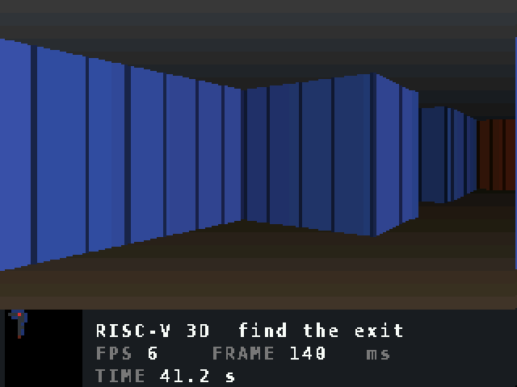

## Verification

Independent checks, all run on every change:

1. **Official riscv-tests**: all 48 `rv32ui` and `rv32um` tests pass, with branch prediction
   on and off (`fence_i` and `ma_data` are skipped on purpose, see below).
2. **Random differential testing**: random RV32IM programs, built to hit forwarding, load-use,
   branches, jumps, loops and back-to-back divides, run on both the RTL and a Python reference model.
   The full commit log (every register write and every store, in order) and the final state
   must match. 120 programs, ~46,600 instructions, 0 mismatches.
3. **Directed testbench** from e-Yantra: 38 instruction checks, all pass.
4. **Accelerator unit test**: 1,000 random tiles (K = 1..64, edge values, accumulate mode),
   cycle-exact timing, plus a full-system check against the CPU's own result.
5. **UVM** ([verif/uvm](verif/uvm/README.md)): one environment for the core and one for the
   accelerator, for Xcelium + IMC. The core environment runs constrained-random programs
   and the riscv-tests, and compares every commit against a C reference model (DPI-C).
   It has SVA on the pipeline, and functional coverage on the ISA, hazards and branch
   prediction. The accelerator environment uses a bus monitor, a reference model and
   SVA on the run length. Results on Xcelium 24.09: core 10/10 and accelerator 7/7
   regression tests pass, 100% covergroup coverage on both, every assertion passing, and
   both planted bugs caught (889 mismatches for a broken load-use stall; every job for a
   run shortened by one cycle). Screenshots in the [UVM README](verif/uvm/README.md).

The random test was checked by planting bugs in the design (removing the load-use stall,
breaking forwarding, wrong divide-by-zero result, missing pipeline bubble during divide,
missing reset flush, missed "predicted taken but not taken" case, wrong redirect address).
Every planted bug was caught.

## On the Basys 3 (Xilinx Artix-7, Vivado)

Step by step: [`docs/basys3_guide.md`](docs/basys3_guide.md).

```
vivado -mode batch -source fpga/basys3/build.tcl      # bitstream with the demo program
vivado -mode batch -source fpga/basys3/program.tcl    # program the board over USB
python sw/load.py COM5 bench                         # load another program, see its output
```

After reset the demo prints the benchmark table measured on the board, shows the CPI on
the 7-segment display ("1.20"), and lets the switches drive the LEDs.


The board reports 276,798 cycles for the whole suite, exactly the same as RTL simulation.

| Basys 3 (XC7A35T-1, Vivado 2026.1) | |
|---|---|
| CPU clock | 50 MHz from the MMCM, timing met (worst slack +1.96 ns, hold +0.04 ns) |
| Slice LUTs | 6,755 / 20,800 (32.5 %), of which the accelerator 4,113 (946 as distributed RAM: two banks of operand buffers and the row buffer) |
| Slice registers | 3,232 / 41,600 (7.8 %) |
| Block RAM | 9 tiles (16 KB IMEM + 16 KB DMEM, DMEM dual-ported for the accelerator) |
| DSP48E1 | 15 (CPU multiplier 4, accelerator 11) |
| Worst path | UART loader hold -> data memory write enable (a half-cycle path: memory writes on the falling edge) |

Before the accelerator work: 1,939 LUTs, 1,207 registers, 4 DSPs, worst slack +2.72 ns
(forwarding compare -> ALU / multiplier -> EX/MEM register).

## Earlier port: Intel Cyclone IV (Quartus)

Before the Basys 3 port, the design was first built for an Intel Cyclone IV E (EP4CE22F17C6,
Quartus Prime Lite 20.1). Those results are kept here because they show the timing work
across the two phases:

| | Phase 1 (RV32IM) | Phase 2 (+ branch prediction) |
|---|---|---|
| Fmax (slow 85 C model) | 57.0 MHz | 56.33 MHz |
| Logic elements | 2,414 (11 %) | 3,378 (15 %) |
| Registers | 650 | 1,196 |
| Memory bits | 264,192 (34 M9K) | 264,800 |
| 9-bit multiplier elements | 8 | 8 |
| CPI on the benchmark suite | 1.52 | 1.20 |

Timing is met at the 50 MHz target in both. The branch target buffer is kept in flip-flops
(about 550 registers) so it can be read in the same cycle as Fetch; it is not on the critical
path. Net speedup including the small Fmax change: 1.26 x 56.33 / 57.0 = **1.25x**.

Timing work done so far:
1. The first critical path was data memory read (falling edge) -> load byte select and sign
   extend -> MEM/WB, in half a cycle. The byte select moved to Writeback (`load_extend.v`).
2. That exposed the branch path: forwarding -> ALU input muxes -> ALU subtract -> branch
   decision -> flush. Branches now use their own comparator and `jalr` its own adder, fed
   directly from the forwarded registers.
3. The critical path is now: load data in Writeback -> forwarding -> single-cycle multiplier
   -> EX/MEM (17.5 ns). Several paths now sit close to the same delay, so the next real gain
   needs a structural change: a 2-cycle (registered) multiplier and rising-edge memories.

## How to run (simulation)

Needs `iverilog`, `python3` and a RISC-V GCC (`riscv64-unknown-elf-gcc`, or the xPack
`riscv-none-elf-gcc` on Windows with `CROSS=riscv-none-elf-`).

```bash
# C program on the CPU
cd sw && make PROG=hello sim

# benchmarks with and without branch prediction
cd sw && make PROG=bench sim && make PROG=bench sim VFLAGS=-DNO_BPRED

# official ISA tests
verif/run_riscv_tests.sh

# random differential test (100 programs)
verif/run_random.sh 100

# Basys 3 top level: UART output, program loader, damaged-program rejection
verif/run_board_tests.sh

# everything
verif/run_all.sh

# original e-Yantra testbench (run from code/ so it finds imem.hex)
cd code && iverilog -g2005 -o tb ../.test/tb.v *.v components/*.v io/*.v accel/*.v && vvp tb
```

To put a C program into the bitstream: `make PROG=hello install` copies its hex files into
`code/`, then rebuild with Vivado (`fpga/basys3/build.tcl`). To run it without rebuilding, use
the UART loader: `python sw/load.py COM5 hello`.

## Repository layout

```
code/             RTL: soc.v (CPU + memories + I/O), pl_riscv_cpu.v (e-Yantra wrapper)
code/components/  pipeline blocks: datapath, hazard unit, ALU, mul/div unit, branch predictor
code/io/          UART TX/RX, UART program loader, 7-segment driver
code/accel/       INT8 systolic-array accelerator: gather engine, array, output stage
ml/mnist/         CNN training (NumPy), INT8 quantisation, golden model, C generator
fpga/basys3/      Basys 3 top level, pin constraints, Vivado build / program scripts
sw/               C toolchain: link.ld, crt0.S, console library, programs/, Makefile
sw/prebuilt/      hello, bench, demo, matmul, mnist, ready to load (no RISC-V compiler needed)
sw/load.py        sends a program to the board over USB-UART
verif/            riscv-tests runner, random test generator + reference model, board-level
                  testbench with a UART model, testbenches
verif/uvm/        UVM environments for the core and the accelerator (Xcelium + IMC)
.test/tb.v        original e-Yantra directed testbench
docs/             design notes for each phase
```

## Known limitations

- No misaligned loads/stores (the ISA allows a core to not support them).
- No CSRs, traps or interrupts, so no ECALL/EBREAK and no operating system.
- Code cannot be modified at run time (separate instruction memory), so `fence.i` is a no-op.
- A wrong branch guess costs 2 cycles (branches resolve in Execute).
- Function returns (`jalr`) are not predicted.
- Performance counters are 32 bits, so they wrap after about 85 s at 50 MHz.

## Roadmap

Done:

- [x] Phase 1: RV32M, block-RAM memories, MMIO, C toolchain, riscv-tests
- [x] Phase 2: performance counters, branch prediction (BTB + 2-bit counters), benchmarks
- [x] Basys 3: UART console, display / LEDs / switches, UART program loader
- [x] INT8 systolic-array accelerator, memory mapped, driven from C
- [x] UVM verification of the core and the accelerator (Xcelium + IMC)
- [x] RTL-to-GDSII of the core on SkyWater 130 nm (LibreLane), timing closed at 20 MHz
- [x] Handwritten-digit recognition: INT8 CNN (98.74 % on MNIST), bit-exact with a golden model
- [x] Accelerator output stage (bias, rescale, ReLU) and gather engine (im2col in hardware):
      11.4x faster CNN inference, measured on the board
- [x] Layer engine (one command per conv layer, max pool in hardware): 26.3x, measured on the board
- [x] 128-step operand buffers (each conv2 patch fetched once): 36.4x, measured on the board
- [x] Bias and scale on chip, results stored in the background: 40.4x, measured on the board
- [x] Double buffering (fetch the next job while the array runs): 58.4x, measured on the board
- [x] Live demo on a 2.4" SPI TFT: digit recognition, edge filter, CPU vs accelerator race,
      drawing on the TFT with a USB mouse (PS/2 port)

## Future work

Roughly in the order I plan to build them. Each block is RTL in Verilog / SystemVerilog with
its own testbench, and is not merged until the existing tests and board demos still pass.

### Core and SoC architecture

- [ ] **Interrupts and CSRs (Zicsr, machine mode):** `mstatus`, `mtvec`, `mepc`, `mcause`,
      `ecall` / `mret`, exceptions for illegal instructions and misaligned accesses, a machine
      timer and external interrupts (UART, PS/2), with precise traps in the 5-stage pipeline;
      proven by the official `rv32mi` riscv-tests
- [ ] **AXI4-Lite interconnect:** replace the plain address decoder with an AXI4-Lite bus;
      the UART, timers, TFT, PS/2 and accelerator become AXI slaves, verified with a UVM
      AXI agent and SVA protocol checks
- [ ] **Floating-point unit (RV32F):** 32 float registers, add / subtract / multiply with
      IEEE-754 rounding, compare, int-float conversion, multi-cycle divide and square root;
      checked against a reference model with random and corner-case operands (NaN, infinity,
      denormals) and the official `rv32uf` tests, with the speedup over GCC's soft-float measured
      on the board
- [ ] **DMA engine:** moves data between memory, the accelerator and the TFT while the CPU
      keeps running
- [ ] **Instruction cache in front of the QSPI flash:** run programs larger than 16 KB straight
      from flash, and boot a program at power-up together with the bitstream
- [ ] **Two-stage multiplier** (or ALU / PC+4 selected in Memory) to shorten the critical path,
      then re-run the sky130 flow for a higher clock

### Accelerator

The accelerator is now limited by memory bandwidth, not by its array:

- [ ] **Line buffer:** keep three input rows on chip and build the 3x3 patches from them, so each
      input byte is read from memory once instead of up to 9 times (how CNN accelerators
      usually handle convolution)
- [ ] **8x8 systolic array** on the DSP slices (75 of 90 are free), once the line buffer can feed
      it: 64 multiply-adds per cycle instead of 16
- [ ] **Fully connected layer and input copy on the accelerator:** together a quarter of the
      remaining time; without them the speedup cannot pass about 235x

### Ascon crypto engine as a peripheral

- [ ] **Ascon on the board, next to the accelerator:** my Ascon core (NIST SP 800-232: AEAD128,
      Hash256, XOF128, CXOF128), built and verified in its own repository,
      [ascon-uvm-crypto-core](https://github.com/higgboson/ascon-uvm-crypto-core)
      - Already done there: UVM on Cadence Xcelium with 100 % coverage closed in IMC, 4,228 of
        4,228 official NIST test vectors, 6 of 6 planted bugs caught, and a memory-mapped
        wrapper with a C driver on this SoC: encryption 31x and hashing 105x faster than the
        official optimised C on the same CPU (RTL simulation)
      - Next: move its registers off `0x3000_0000`, which the TFT controller now uses, then on
        to the AXI4-Lite bus with the other peripherals
      - Vivado timing and a run on the Basys 3, with the speedup measured on the board
      - A live demo on the TFT: encrypt a message, decrypt it, then flip one bit and watch the
        tag check reject it

### Verification

- [ ] **UVM for the gather and layer engines:** the UVM environment drives the accelerator the
      original way, so its code coverage is 53 %; sequences for the engines would close that gap
- [ ] **riscv-dv** random instruction streams on the core, compared against the reference model
- [ ] **Formal verification:** SymbiYosys on the accelerator and the gather engine, riscv-formal
      on the core
- [ ] **GitHub Actions:** run the Verilator UVM tests and the riscv-tests on every push

### Peripherals and software

- [ ] **VGA output** (640x480) on the Basys 3's VGA port, as a second display
- [ ] **PS/2 keyboard:** scan codes and the Num Lock LED, next to the mouse
- [ ] **A small operating system of my own,** once the interrupts are in: a kernel with system
      calls, a timer-driven round-robin scheduler and context switching, and a shell on the TFT
      that runs the demos as processes side by side. (Linux is out of reach: it needs an MMU and
      megabytes of RAM; the Basys 3 has about 225 KB of block RAM and no external memory.)
