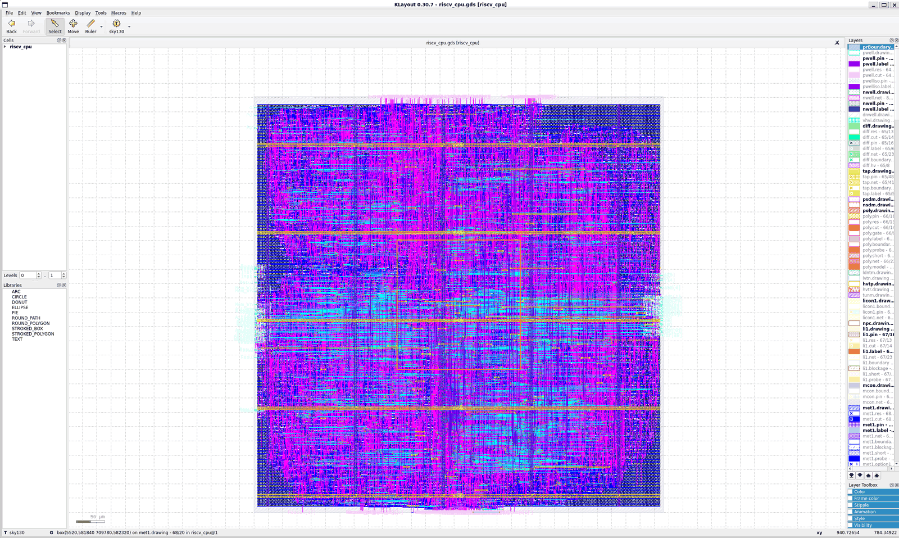

# RTL to GDSII: the CPU core on SkyWater 130 nm (LibreLane)

Hardens `riscv_cpu` (the 5-stage RV32IM pipeline) into a layout. The instruction and data
memories stay outside the block as ports, the usual way a core is delivered as a macro.

| Setting | Value | Why |
|---|---|---|
| PDK | sky130A (default) | open-source 130 nm process |
| Clock | 50 ns (20 MHz) | closes the slow corner (ss, 100 C, 1.60 V) |
| Core utilisation | 40 % | leaves room for routing ~18k cells |
| Placement density | 50 % | |

## Results (LibreLane, sky130A, 20 MHz)



| Metric | Value |
|---|---|
| Die area | 0.52 mm² (about 722 x 722 µm), 52% utilisation |
| Cells | about 18k logic cells (99k including fill, tap and decap cells) |
| DRC (Magic, KLayout, router) / LVS / antenna | 0 / 0 / 0 |
| Setup slack, worst corner (ss, 100 °C, 1.60 V) | +3.6 ns, 0 violations: closes at 20 MHz, limit ~21 MHz |
| Setup slack, typical corner (tt, 25 °C, 1.80 V) | +16.6 ns: the core runs at about 30 MHz |
| Hold slack (all corners) | +0.11 ns, 0 violations |
| Power (typical) | about 11 mW |

## Timing closure, step by step

| Run | Change | Worst setup slack | Violations |
|---|---|---|---|
| 1 | 40 ns clock, default constraints | -3.28 ns | 8 |
| 2 | own SDC (I/O delays, drive, load), post-route repair | -3.36 ns | 6 |
| 3 | RTL: flushes clear only control bits, PerfEvents registered | -6.43 ns | 1452 |
| 4 | 50 ns clock | **+3.62 ns** | **0** |

STA on run 2 showed the slowest path was the mispredict flush net (clearing about 200
flip-flops through a buffer chain, ending at the PerfEvents output). Run 3 removed that path;
the next one exposed is `dp.plmw.ResultSrcW` -> Writeback result mux (32 bits) -> forwarding
into Execute -> single-cycle 33x33 multiplier, about 45 ns in the slow corner. It is the same
path that limits the FPGA build. Next step: a two-stage multiplier, or choosing ALU / PC+4
one stage earlier, to take that chain out of one cycle.

## Run

Inside the LibreLane Nix shell (`cd ~/librelane && nix-shell`):

```sh
cd <this repo>/asic/riscv_cpu
librelane config.json
```

The result is in `runs/<tag>/final/`: `gds/riscv_cpu.gds` plus timing, area and power reports.

To look at the layout:

```sh
librelane --last-run --flow OpenInKLayout config.json
```
